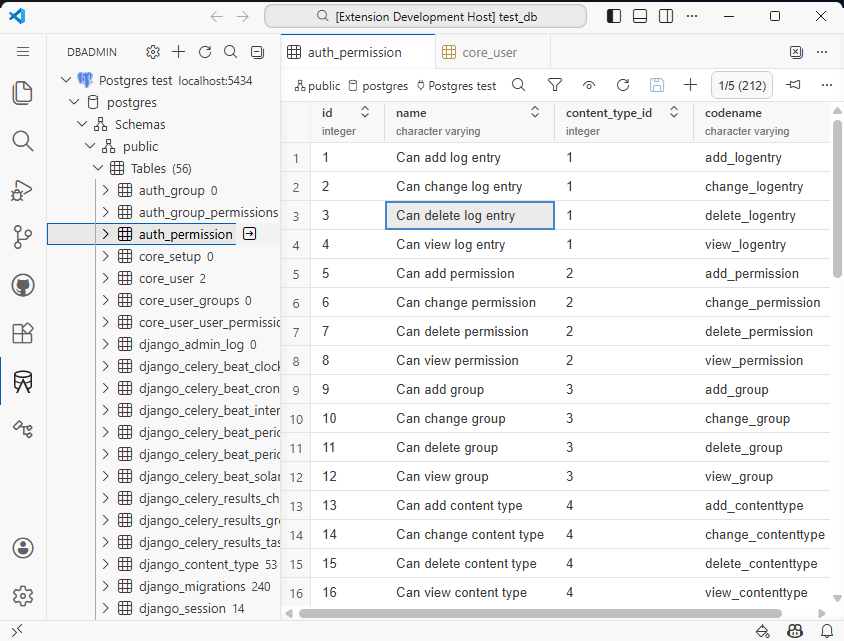
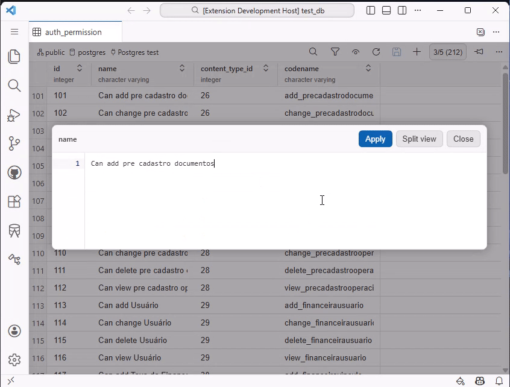
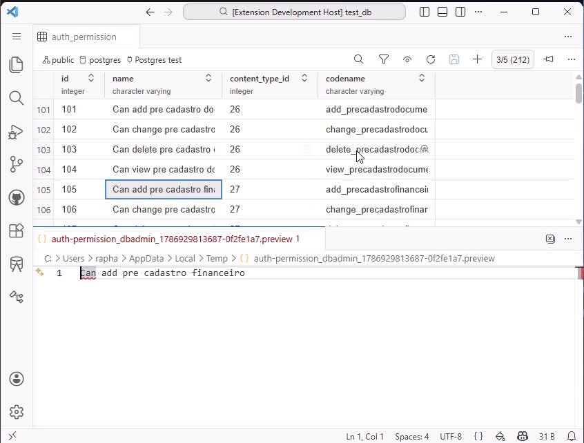
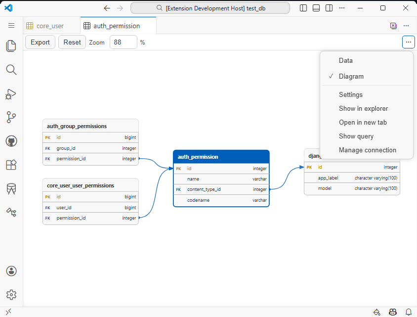
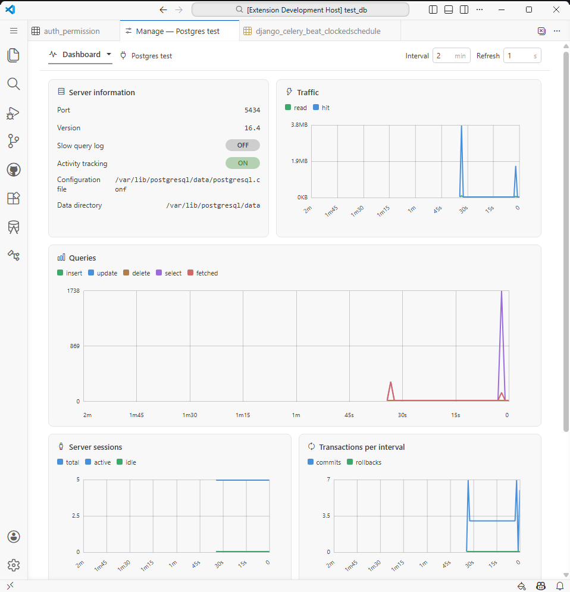

# DBAdmin — PostgreSQL with a modern UI in VS Code

DBAdmin brings a **lean, visual, and powerful** database experience into VS Code.  
Connect, explore, filter, query, and operate PostgreSQL without leaving the editor.

## Why DBAdmin

- **Modern, focused UI**: the essentials, without visual clutter.
- **Fast workflow**: common actions are a few clicks away.
- **Built for real use**: data browsing, metadata, DDL, export, backup, and restore.

## Main features

- **Tree explorer**: connections → databases → schemas → tables, views, functions, procedures, triggers, and extensions.
- **Connection management**: create, edit, and remove connections with global persistence; optional database allowlists per connection.
- **Table view**: pagination, column filters, in-place editing, FK navigation, copy/paste, and smooth navigation.
- **Table DDL**: show the full `CREATE TABLE` script (columns, defaults, constraints, indexes, foreign keys); create or drop tables from the tree or table menu.
- **Metadata panels**: browse columns and constraints under each table; edit column nullable/default values.
- **Schema & database ops**: create/rename/duplicate/drop databases; create/drop/clear/backup/restore schemas.
- **Routines**: create, edit, and delete functions, procedures, and triggers via the SQL runner.
- **ER diagram**: see how the current table relates to its neighbors, highlight relationships, then export or jump to another table.
- **Data export**: CSV and JSON from the table view or query results.
- **SQL Book & SQL runner**: interactive query execution with grid results; optional inline table that can persist in the `.sqlbook` file; run statements from `.sql` files with connection context.
- **Connection dashboard**: watch traffic, queries, sessions, and transactions for a live connection.
- **Backup and restore**: native schema dump or integration with `pg_dump` and `pg_restore`.
- **MCP**: AI tools can list connections, inspect schemas, and run SQL using saved DBAdmin credentials.

### Explorer

Open the DBAdmin view, expand a connection, and jump straight into a table. Right-click for DDL, truncate, delete, and more.

### Table editor

Browse rows, filter by column, paginate, and edit in place.

### ER diagram

See how the current table relates to its neighbors, then export or jump to another table.

### Connection dashboard

Watch traffic, queries, sessions, and transactions for a live connection.

## Installation

1. Open the Marketplace in VS Code.
2. Search for **DBAdmin**.
3. Click **Install**.

Alternatively via VSIX:

1. Download the `.vsix` from the release.
2. Run **Extensions: Install from VSIX...**.

## Requirements

- VS Code 1.85+
- Access to a PostgreSQL server
- `pg_dump` and `pg_restore` for pgAdmin-style backup features (optional; DBAdmin can also dump schemas natively)

## Development

See [docs/development.md](docs/development.md) for local build, VSIX packaging, and Marketplace publishing.

## Roadmap

**1.0 — PostgreSQL foundation (now).** Explorer, table editor, ER diagram, connection dashboard, table DDL, SQL Book, backup/restore, and MCP — all inside VS Code.

**Next:**

- **Universal database manager** — expand beyond PostgreSQL to MySQL/MariaDB, SQLite, SQL Server, and other engines, reusing the same explorer, grid, and query experience.
- **Standalone Electron app** — the same UI outside VS Code for teams that want a dedicated database client.

The editor stays the home for the core workflow. New database engines land one at a time on top of the PostgreSQL foundation shipped in 1.0.
